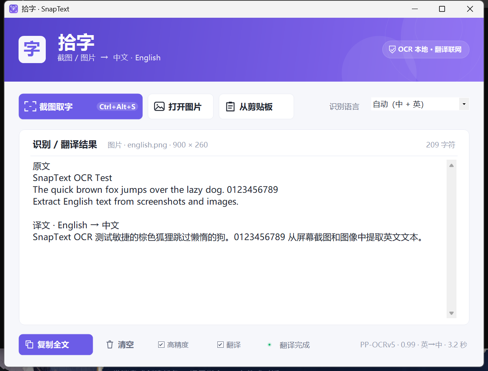

# 拾字 · SnapText

[](https://github.com/fangtunan/snaptext/actions/workflows/build.yml)
[](https://github.com/fangtunan/snaptext/releases/latest)
[](LICENSE)

一个专为 Windows 设计的轻量截图取字工具：从屏幕或图片中提取**中文 / 英文**文字，结果显示在窗口里，可直接编辑和复制。

> OCR 识别完全在本机完成，截图和图片不会上传。**翻译模式需要联网**：开启后，识别出的文字会发送到 MyMemory 在线翻译服务，图片不会上传。

[下载最新版本](https://github.com/fangtunan/snaptext/releases/latest) · [隐私政策](PRIVACY.md) · [更新日志](CHANGELOG.md)



## 功能

- **全局快捷键截图**：默认 `Ctrl+Alt+S`。同时会注册 `Ctrl+Shift+Q`、`Alt+Shift+S` 作为备用快捷键。
- **两种截图方式**：
  - 拖动鼠标，框选任意矩形区域；
  - 在窗口上单击，直接提取整个窗口。
- **Shift 多区域框选**：按住 `Shift` 连续框选多个矩形，按 `Enter` 或点击「提取 N 个区域」，文字按框选顺序依次写入结果。
- **直接提交图片**：
  - 打开本地图片（`Ctrl+O`）；
  - 把图片拖进窗口；
  - 读取剪贴板里的图片（例如 `Win+Shift+S` 截图后）。
- **中英文识别**：默认使用本地 PP-OCRv5 高精度模型，支持中文、英文以及中英混排；可切换回 Windows 快速 OCR。
- **高精度 / 快速切换**：主窗口底部「高精度」复选框；高精度模式首次识别会加载模型，略慢但准确率明显更高。
- **自动中英翻译**：打开「翻译」后，自动判断中文→English 或 English→中文；左侧显示原文，右侧显示译文。两栏共用一个滚动条、逐行对齐，每行下方有浅灰色分隔线。翻译需要联网，首次启用会明确提示文字会发送到 MyMemory。
- **结果可编辑**：识别结果会显示在主窗口，可直接修改、全选、复制；开启翻译时，双击表格中的原文或译文单元格即可编辑，编辑后的原文会覆盖当前识别结果。
- **托盘常驻**：关闭窗口只是隐藏到托盘，快捷键继续可用；从托盘菜单选择「退出拾字」才会完全退出。
- **单实例**：重复启动会唤回已经打开的窗口。

## 使用方法

从 [GitHub Releases](https://github.com/fangtunan/snaptext/releases/latest) 下载 `SnapText-1.2.6-win-x64.zip`，解压后运行 `SnapText.exe`。

> Release 包为自包含版本，无需单独安装 .NET。首次运行 SmartScreen 可能提示“未知发布者”，这是因为当前版本尚未购买代码签名证书。

关闭主窗口不会退出应用，而是隐藏到系统托盘，快捷键继续可用；需要完全退出时，请右键托盘图标选择「退出拾字」。

1. 按 `Ctrl+Alt+S`（或点击主窗口的「截图取字」）。
2. 屏幕变暗后：
   - 按住鼠标左键拖动，框选要识别的区域；
   - 或把鼠标移到某个窗口上单击，提取整个窗口；
   - 按 `Esc` 或右键取消。
3. 松开鼠标后，主窗口会显示识别结果。

截图开始前，拾字主窗口会先完全隐藏并等待桌面合成完成，因此不会出现在截取的画面里。

### 一次框选多个区域

1. 按住 `Shift` 拖动，框出第一个矩形；
2. 继续按住 `Shift` 拖动，框出第二、第三个矩形；
3. 按 `Enter`，或点击底部的「提取 N 个区域」；
4. 识别结果会按框选顺序依次拼接到结果窗口，区域之间用空行分隔。

`Backspace` 可撤销上一个框选区域；`Esc` 取消本次截图。

也可以直接：

- 点击「打开图片」选择图片；
- 把图片文件拖入窗口；
- 截图到剪贴板后点击「从剪贴板」。

仓库里的 `samples\mixed.png` 和 `samples\english.png` 可用于快速测试。

识别语言可以在右上角切换（主要用于快速模式）：

- **自动（中 + 英）**：快速模式先用中文引擎，纯英文时自动改用英文引擎；
- **中文（含英文）**：适合大部分中文界面；
- **English**：适合纯英文内容。

底部的「高精度」复选框默认开启：

- 中文和中英混排使用本地 PP-OCRv5 模型，首次识别会加载模型；
- 纯英文屏幕文字自动使用 Windows OCR，速度更快，清晰截图通常更准确；
- 关闭后统一使用 Windows OCR 快速模式；
- 高精度模型文件缺失或加载失败时，会自动回退 Windows OCR，并在元信息中提示。

高精度模式会随程序携带约 48 MB 的模型和 native 运行库；自包含 Release 体积会更大，具体以下载页显示为准。OCR 完全离线，不下载、不上传。

### 翻译模式

主窗口底部的「翻译」复选框默认关闭：

- 开启后，自动检测识别结果的主要语言：中文为主时译为 English，英文为主时译为中文；
- 窗口使用一个共享滚动条的双栏表格：左侧原文、右侧译文，逐行对齐，每行下方为浅灰色分隔线；
- 双击任意单元格可编辑，编辑后的原文会同步覆盖当前识别结果，复制使用编辑后的内容；
- 关闭翻译不会重新 OCR，会保留编辑后的原文；重新开启时直接翻译编辑后的内容；
- 翻译服务为 MyMemory，免费额度有限，网络异常或额度用完时会保留原文并显示错误；
- 首次启用会弹出确认框，说明识别文字会发送到 MyMemory；图片、截图不会上传。

## 环境要求

- Windows 10 版本 2004（Build 19041）及以上，或 Windows 11。
- 下载自包含 Release 时无需安装 .NET；源码构建需要 [.NET 8 SDK](https://dotnet.microsoft.com/download/dotnet/8.0)。
- 快速模式/回退模式需要已安装中文和/或英文的 Windows OCR 语言组件；高精度模式自带模型，不依赖系统 OCR 语言包。
- 使用翻译模式需要能访问 `api.mymemory.translated.net` 的网络。

检查 OCR 语言：

`设置` → `时间和语言` → `语言和区域`，确认「中文（简体）」或「English」已安装。Windows 通常会自动安装 OCR 组件。

如果 Windows OCR 中文引擎不可用，快速模式会回退英文引擎；高精度模式不依赖它。

## 构建

需要 [.NET 8 SDK](https://dotnet.microsoft.com/download/dotnet/8.0)。

```powershell
.\SnapText\build.ps1
```

默认发布自包含单文件版本到 `dist`，目标机器无需安装 .NET。高精度模型位于 `SnapText/models/ppocrv5/`，构建时会自动复制。

构建脚本会还原以下 NuGet 依赖：

- `RapidOcrNet`
- `SkiaSharp.NativeAssets.Win32`
- `System.Numerics.Tensors`

> `SnapText/build-csc.ps1` 是本地无 SDK 构建脚本，依赖 `tools/packages` 中的本机工具链；该目录不提交到 GitHub，公开构建请使用上面的 SDK 流程。

## 命令行测试模式

发布后的 `SnapText.exe` 可以无界面运行 OCR 测试：

```powershell
.\SnapText.exe --ocr .\samples\mixed.png .\result.txt auto accurate
```

参数依次为：输入图片、输出文本、语言（`auto` / `zh` / `en`）、精度（`accurate` / `fast`）。省略精度参数时使用 `fast`。结果写入 `result.txt`，元数据写入 `result.txt.meta.txt`。

翻译也可以单独测试（会联网）：

```powershell
.\SnapText.exe --translate .\source.txt .\translated.txt
```

方向根据文本自动判断，元数据包含 `From` / `To` 和翻译服务名称。

## 常见问题

**快捷键没有反应**

- 应用必须保持运行：关闭主窗口只会隐藏到托盘，快捷键仍然有效；如果从托盘菜单退出了应用，需要重新运行解压后的 `SnapText.exe`。
- 快捷键可能被其他软件占用。应用启动时会同时尝试注册三组快捷键，主窗口「截图取字」按钮上会显示主快捷键；托盘菜单也会显示实际可用的组合。
- 即使全局快捷键被占用，也可以直接点击主窗口的「截图取字」。

**识别不到文字**

- 确认框选区域包含文字，且文字不要太模糊；
- 保持「高精度」开启，或尝试放大截图区域/使用更高分辨率的原图；
- 纯英文内容可切换为 `English`（快速模式）；
- 查看日志：`%LOCALAPPDATA%\SnapText\snaptext.log`。

**高精度模式第一次识别比较慢**

首次使用需要加载约 20 MB 的 PP-OCRv5 模型，之后会复用已加载的引擎。高精度模式仍然完全离线。

**翻译失败或提示额度用完**

翻译模式使用 MyMemory 免费接口，受网络和每日额度限制。失败时会保留原文并显示错误；可以关闭「翻译」继续使用本地 OCR，或稍后重试。

**是否会上传图片？**

不会。高精度使用本地 PP-OCRv5/ONNX Runtime，快速模式使用 Windows 本地 OCR，截图和图片都不上传。

翻译模式开启后，只有**识别出的文字**会发送到 MyMemory 在线翻译服务；图片、截图和剪贴板内容不会上传。详见 [PRIVACY.md](PRIVACY.md)。

## 技术说明

- .NET 8 + Windows Forms。
- 高精度 OCR：中文/中英混排使用 PP-OCRv5 mobile + RapidOcrNet + ONNX Runtime，本地 CPU 推理；纯英文屏幕文字自动使用 Windows OCR，避免宽图降采样导致漏字。
- 快速/回退 OCR：`Windows.Media.Ocr`，中文使用 `zh-Hans-CN` 引擎，英文使用 `en-US` 引擎。
- 翻译：按 CJK/拉丁字母数量判断主语言；通过 `api.mymemory.translated.net` 生成译文，OCR 与翻译解耦。
- 截图：GDI 屏幕捕获 + 自绘全屏选择层，支持多显示器与高 DPI。
- 通过单词边界框重建行内空格；高精度结果会保留 PP-OCR 的平均置信度。
- 第三方组件和模型许可见 `NOTICE-OCR.txt`。

## 准确率测试

使用 `tests/ocr-fixtures/` 中的中英文截图测试，按字符错误率（CER，忽略空白）计算：

| 模式 | 中英混排 CER | 纯英文 CER | 平均 |
| --- | ---: | ---: | ---: |
| 快速（Windows OCR） | 7.8% | 0.0% | 3.9% |
| 高精度（PP-OCRv5） | 0.5% | 0.0% | 0.3% |

复测命令：

```powershell
powershell -ExecutionPolicy Bypass -File .\tools\compare-ocr.ps1
```

## 项目结构

```
SnapText/
  Program.cs            程序入口、单实例、OCR 命令行测试
  MainForm.cs           主窗口与交互
  CaptureOverlayForm.cs 全屏截图/窗口选择层
  OcrRouter.cs          快速/高精度引擎路由与回退
  OcrService.cs         Windows OCR 封装与文本整理
  PpOcrService.cs       PP-OCRv5 高精度 OCR
  TranslationService.cs 中英方向检测与 MyMemory 在线翻译
  NativeMethods.cs      Win32 互操作
  models/ppocrv5/       PP-OCRv5 本地模型
  Controls/             自绘按钮、卡片、标题栏等
  Assets/app.ico        应用图标
  NOTICE-OCR.txt        第三方组件许可说明
  build-csc.ps1         本地无 SDK 构建脚本（需本机工具链）
  build.ps1             .NET SDK 构建脚本
```

仓库还包含：

- `tests/ocr-fixtures/`：中英文 OCR 准确率测试图片与期望文本；
- `tools/compare-ocr.ps1`：对比快速/高精度 OCR 的字符错误率（CER）；
- `.github/workflows/build.yml`：GitHub Actions 构建与 Release；
- `LICENSE`：MIT 许可证；
- `PRIVACY.md`：隐私政策。

## 许可证

代码使用 [MIT License](LICENSE)。高精度 OCR 使用的 PP-OCRv5 模型、RapidOcrNet、ONNX Runtime、SkiaSharp 等第三方组件遵循各自许可证，详见 [NOTICE-OCR.txt](NOTICE-OCR.txt)。

## 隐私

OCR 和截图均在本机完成，不上传图片、截图或识别结果。

翻译模式默认关闭；开启后，识别出的文字会发送到 MyMemory 在线翻译服务，图片不会上传。详见 [PRIVACY.md](PRIVACY.md)。
